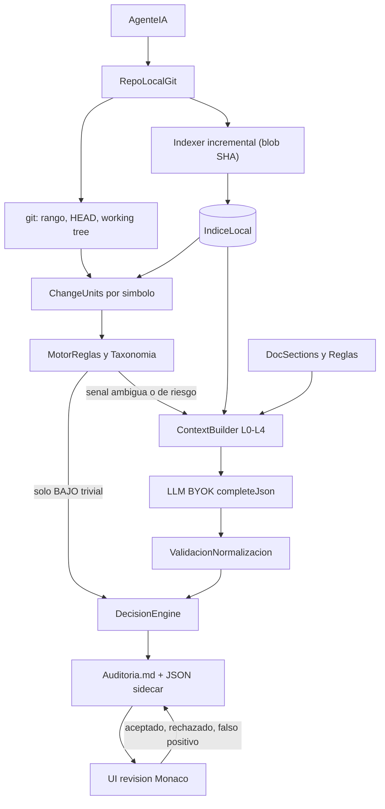

# Auditor de cambios de agentes IA sobre ArchTrace

## 1. Diagnóstico del proyecto actual

ArchTrace es hoy un tutor visual: `extension/` (bridge WS + tree-sitter + git), `web/` (Next 16 + React Flow + BYOK LLM) y `core/` (tipos + funciones puras como `rankSources`). Un único commit (`ac183ce`), tests con `node --test` + `tsx`.

### Se reutiliza tal cual
- **AST estructural**: [extension/src/scan/](extension/src/scan/) — Python y JS/TS/TSX con clases, funciones, métodos, `range` 1-based, imports resueltos y llamadas (`ProjectMap` en [core/src/projectMap.ts](core/src/projectMap.ts)). [nodeScan.ts](extension/src/scan/nodeScan.ts) ya funciona sin VS Code y `ParserHost.parse(language, path, text)` acepta texto arbitrario (sirve para escanear la versión base y la head de un archivo).
- **Git seguro**: `isSafeRef`, `runGit` (execFile sin shell), `parseNameStatus`, `workspaceMapper` en [extension/src/gitDiff.ts](extension/src/gitDiff.ts).
- **LLM BYOK**: [web/src/lib/ai/](web/src/lib/ai/) — 6 proveedores, `completeJson` con JSON Schema estricto (OpenAI/Gemini/Anthropic tool), `parseProviderJson` tolerante, `withTransientRetry`, `estimateCost`/`approximateTokens`. Es Node puro salvo `useServerKeys.ts`, `settings.ts` y `secureStore.ts` (navegador).
- **Patrón híbrido heurística + caché + LLM**: [web/scripts/lib/classifyModules.ts](web/scripts/lib/classifyModules.ts), [aiClassifier.ts](web/scripts/lib/aiClassifier.ts), [classificationCache.ts](web/scripts/lib/classificationCache.ts) (caché por hash de contenido).
- **Filtro de secretos**: [web/src/lib/github/sensitiveFilter.ts](web/src/lib/github/sensitiveFilter.ts) (nunca enviar `.env`, claves, etc. al LLM).
- **Señales semánticas**: [web/src/lib/scan/semantics.ts](web/src/lib/scan/semantics.ts) (detección de BD, brokers, infra) como semilla de reglas.
- **Navegación al IDE**: `NAVIGATE_TO_CODE` + [editorLink.ts](web/src/features/canvas/lib/editorLink.ts) para "abrir en VS Code en la línea".
- **Shell del dashboard**: [GlobalSidebar.tsx](web/src/features/dashboard/GlobalSidebar.tsx), [routes.ts](web/src/features/dashboard/routes.ts), `PageShell`, bóveda BYOK.

### Se reutiliza con modificaciones
- `gitDiff` solo devuelve `--name-status`: hay que añadir parseo de parches unificados (hunks, líneas +/-), working tree y archivos sin seguimiento.
- `completeJson` devuelve `unknown` sin `usage`: ampliar a `{ value, usage }` para medir tokens por auditoría.
- `health/` (`Finding` por severidad + `ArchitectureCheckPanel`) sirve de modelo para la lista de hallazgos, no como tipo final.
- `blastRadius.ts` y el `ProjectMap` (calls) alimentan el nivel 3 de contexto ("componentes relacionados").
- `features/lesson/lib/markdown.ts` (detección de headings) como base del seccionador de documentación.

### Se oculta (no se borra)
Canvas como pantalla principal, `simulation/`, `playground/`, `lesson/` guiada, `demos/`, `landing/`, `billing/` (no debe limitar auditorías), `localServices/`, `trace/`. El canvas queda accesible como vista secundaria "Mapa de arquitectura".

### No existe y hay que crear
Parches con hunks, mapeo hunk a símbolo, seccionado de `CLAUDE.md`/`.cursor/rules`/docs, taxonomía, motor de reglas, recuperación jerárquica de contexto, motor de decisión, `Auditoria.md`, estado de revisión, visor de diff (no hay Monaco), métricas de tokens. RAG actual ([web/src/lib/rag/](web/src/lib/rag/)) es didáctico (bag-of-words en memoria, sin Qdrant): no se reutiliza para producción.

## 2. Arquitectura objetivo

### Paquetes (respetando las fronteras del monorepo)
- `scanner/` (nuevo, movido desde `extension/src/scan/` salvo `scanner.ts`, que depende de `vscode`): consumido por la extensión y el auditor vía alias `@scanner/*`. La extensión mantiene su build < 5 MB.
- `llm/` (nuevo, movido desde `web/src/lib/ai/` sin los archivos de navegador): `web/src/lib/ai/*` queda como re-export para no romper imports.
- `auditor/` (nuevo): CLI `archtrace-audit` + servidor HTTP en `127.0.0.1:8090` con allowlist de `Origin` (mismo criterio de seguridad que la extensión). Las claves BYOK llegan del web en cada petición y nunca se persisten; en modo CLI se leen de env u Ollama local. Esto se documenta como extensión explícita de la regla BYOK de `CLAUDE.md`.
- `core/src/audit.ts` (nuevo): tipos compartidos `Criticality` (`critical|high|medium|low|unknown`), `ReviewStatus` (`pending|reviewed|accepted|rejected|false_positive`), `ChangeUnit`, `Signal`, `Evidence`, `RuleRef`, `SemanticAssessment`, `Finding`, `AuditMetrics`, `AuditRun`.
- `web/`: solo UI; habla con el auditor por HTTP (`NEXT_PUBLIC_AUDITOR_URL`).

### Módulos de `auditor/src/`
- `git/`: `diff -U0 --no-color -M -z` para rango, base vs `HEAD`, y working tree (`git diff HEAD` + `git ls-files --others --exclude-standard`). Parser de hunks propio (sin dependencias). Excluye los artefactos propios (`Auditoria.md`, `.archtrace/`).
- `index/`: índice en `~/.archtrace/index/<hashRepo>/` (fuera del repo). Registro por archivo con blob SHA (`git ls-files -s`, `git hash-object` para archivos sucios), símbolos, imports, calls y secciones de docs. Reindexado incremental: solo los blobs cambiados se reparsean. JSON en MVP; SQLite más adelante si hace falta.
- `docs/`: descubre `CLAUDE.md`, `AGENTS.md`, `.cursorrules`, `.cursor/rules/**/*.mdc`, `.claude/**`, `docs/**/*.md`, `README*`. Las trocea por headings en `DocSection { id: "CLAUDE.md#authorization", headingPath, lines, text }` y extrae frases de tipo regla ("debe", "nunca", "crítico", "requiere revisión", "must", "never").
- `changes/`: hunk a símbolo envolvente (escaneo head para líneas añadidas, base vía `git show base:path` para líneas eliminadas). Agrupa en `ChangeUnit` (archivo, símbolo, líneas, +/-), con id estable = hash del contenido del hunk.
- `rules/`: taxonomía por defecto (las 18 categorías pedidas) en `auditor/taxonomy.default.json`, ampliable con `.archtrace/taxonomy.json` del repo. Detectores sobre líneas cambiadas y rutas: `has_perm`, `@login_required`, `permission_classes`, JWT/sesión, filtros `tenant`/`organization_id`, `db.session.execute`/SQL crudo, migraciones, `requests`/`httpx`/SDKs externos, `amount`/`refund`/`stripe`, settings/env, Dockerfile/CI, CSS/i18n/tests/docs. Cada señal guarda token, línea y regla. Las reglas del repo cuya sección coincide con la categoría elevan el suelo de criticidad.
- `context/`: escalado progresivo con presupuesto de tokens por nivel: L0 hunk, L1 función envolvente, L2 clase + imports + firmas relacionadas, L3 llamadores/llamados del `ProjectMap`, L4 secciones de docs recuperadas. Escala solo si el LLM responde `needs_more_context` o la confianza queda bajo el umbral (máx. 2 escalados).
- `retrieval/`: interfaz `Retriever`. MVP con BM25 léxico sobre `DocSection` (sin dependencias). Fase posterior: `QdrantRetriever` (REST a `localhost:6333` vía `fetch`) + embeddings Ollama (`nomic-embed-text`), Qdrant añadido a [web/docker-compose.yml](web/docker-compose.yml). Embeddings por sección de doc y por símbolo, nunca por línea.
- `semantic/`: prompt versionado + JSON Schema de salida (campos del ejemplo del enunciado + `needs_more_context`). Caché por hash(hunk + nivel de contexto + modelo + versión del prompt).
- `decision/`: puro y testeable. Valida categoría contra la taxonomía, descarta evidencias que no aparecen literalmente en el diff y referencias a reglas inexistentes en el índice, aplica el suelo de criticidad de señales deterministas fuertes (el LLM no puede bajar un `has_perm` por debajo de ALTA) y marca `unknown` + `humanReviewRequired` si falta evidencia o la confianza es < 0,5. Registra el origen de cada campo (regla, LLM o ambos).
- `report/`: escribe `Auditoria.md` en la raíz del repo (auditoría vigente) + `.archtrace/audits/<auditId>.json` (reconstrucción completa y evaluación). Ids por categoría (`AUTH-001`, `AUTHZ-002`…).
- `metrics/`: tokens in/out, nº de llamadas, latencia por etapa, tokens de contexto por nivel, líneas totales frente a líneas priorizadas, unidades resueltas sin LLM.
- `server/` + `cli/`: `POST /repos` (vincular + índice inicial), `POST /audits` (base, head, modo, taskId, plan opcional), `GET /audits/:id`, `PATCH /audits/:id/findings/:fid` (estado de revisión + nota), `GET /files?ref=&path=` (contenido para Monaco).

### Trazabilidad
`AuditRun` guarda taskId/requisito y ruta del plan del agente (opcionales), commits base/head, y por hallazgo: unidad de cambio, señales, secciones de reglas usadas, nivel de contexto alcanzado, salida LLM normalizada, tests modificados en el mismo diff que tocan el símbolo o módulo, y revisión humana (estado, nota, fecha).

## 3. UI de revisión (web)
- Rutas nuevas: `/dashboard/audit` (vincular repo, elegir modo/rango, historial) y `/dashboard/audit/[id]` (revisión). `/` y el sidebar apuntan a Auditorías; "Mapa de arquitectura" pasa a entrada secundaria.
- Resumen por criticidad (críticos/altos/medios/bajos/desconocidos) y cola ordenada por criticidad y después confianza.
- `@monaco-editor/react` `DiffEditor` con el loader apuntando al paquete local `monaco-editor` (sin CDN, coherente con zero-retention). Decoraciones de línea y glifos de gutter por criticidad sobre las líneas exactas del hallazgo.
- Panel lateral: motivo, categoría, confianza, evidencias, reglas (enlazan a la sección del doc), origen de la decisión y tokens usados.
- Acciones: anterior / siguiente, revisado, aceptado, rechazado, falso positivo (atajos `j`/`k`/`a`/`r`/`f`), con persistencia inmediata en `Auditoria.md`. "Abrir en VS Code" vía `NAVIGATE_TO_CODE` si la extensión está conectada.
- Store `zustand` en `web/src/features/audit/` y cliente HTTP en `web/src/lib/auditor/` (separado de la UI). Antes de tocar rutas, consultar `web/node_modules/next/dist/docs/` (Next 16, según [web/AGENTS.md](web/AGENTS.md)).

## 4. MVP (fases incrementales)
- **Fase 0, extracción sin cambio de comportamiento**: mover `scanner/` y `llm/`, ajustar aliases de esbuild/tsconfig, `completeJson` con `usage`; todos los tests actuales en verde y check de tamaño de la extensión.
- **Fase 1, pipeline determinista**: git con hunks (los 4 modos), hunk a símbolo, índice incremental, docs seccionados, taxonomía + reglas, motor de decisión sin LLM, `Auditoria.md` + JSON, CLI. Tests con un repo git fixture creado en el propio test: `payments/service.py` con `amount = int(amount)` da MEDIA o menos sin LLM; `players/views.py` con `has_perm` + 403 da CRÍTICA/autorización citando la regla de `CLAUDE.md`; un cambio CSS da BAJA sin llamada al LLM; un segundo run sin cambios no reparsea nada.
- **Fase 2, capa semántica**: context builder L0 a L2 + L4 léxico, LLM con schema, validación, caché, métricas de tokens. Tests con proveedor falso: evidencias inventadas se descartan, categoría fuera de taxonomía da `unknown`, escalado de contexto limitado.
- **Fase 3, servidor + UI**: API HTTP, páginas de auditoría, Monaco con resaltado, navegación y marcado de revisión persistido. Verificación manual: auditar `HEAD~1..HEAD` del fixture, revisar un hallazgo y ver el estado actualizado en `Auditoria.md`.

## 5. Después del MVP
Qdrant + embeddings Ollama, nivel L3 (componentes relacionados vía calls/blast radius), taxonomía derivada de la documentación del repo, enlace con plan del agente y tests, arnés de evaluación (`auditor/eval/`: dataset de commits etiquetados y cálculo de precisión, recall, FP/FN, líneas priorizadas frente a totales, tokens y llamadas por auditoría), actualización de [docs/WEBSOCKET_PROTOCOL.md](docs/WEBSOCKET_PROTOCOL.md) (hoy no documenta `GIT_*` ni `LOCAL_SERVICES`).

## 6. Riesgos y decisiones abiertas
- Escribir `Auditoria.md` en el repo genera a su vez un cambio git: se excluye explícitamente del análisis.
- Lenguajes sin gramática tree-sitter (YAML, SQL, Dockerfile, CSS) se analizan solo por ruta + hunk, sin símbolos.
- El contenedor Docker del web no ve el disco: el auditor corre en el host y el web lo alcanza vía `host.docker.internal`.
